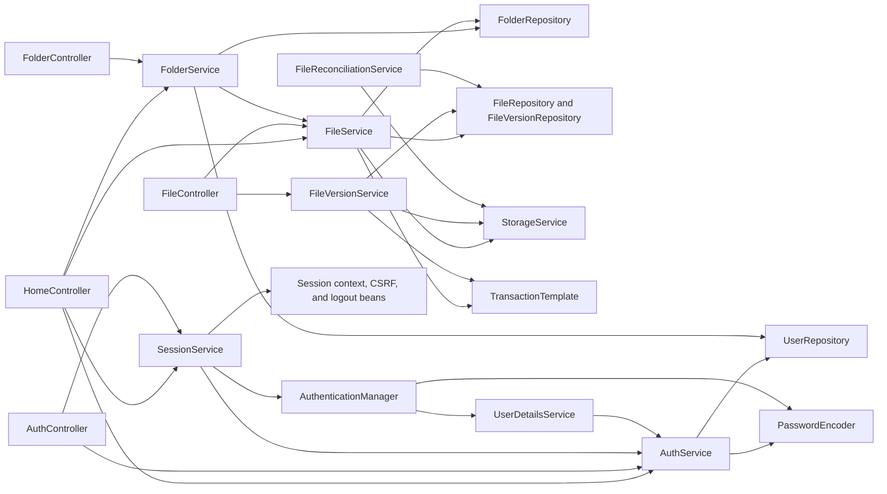

# Cloud Storage Backend

Spring Boot HTTP API for private file storage. PostgreSQL stores users, folders, file metadata, status and checksums. File contents are streamed to a private local directory using server-generated UUID keys; client filenames are metadata only.

The root-level `DocsServer.java` and `DocsClient.java` are integrated with this backend. `DocsServer` launches the Spring Boot application; `DocsClient` is an interactive Java HTTP client for account login/registration and file/folder operations. The Java client relies on the backend for authentication, authorization, SQL metadata, and file storage; it does not maintain a separate TCP storage protocol.

## Task 01 — MVC architecture

This section records the architecture at the end of Task 01. The current browser routes and view are described under Task 02.

Previously, the browser loaded the static workspace directly and every application controller was a REST controller. The authentication controller managed the servlet session and security context, and the folder controller assembled folder contents from two services. File and folder controllers also shared PATCH parsing through the file controller. SQL and physical storage already had dedicated layers.

| Package or resource | Responsibility |
|---|---|
| `controller.mvc` | `HomeController` handles `GET /`, prepares the authenticated `currentUser` model attribute through `AuthService`, and forwards to the existing `/index.html`. |
| `controller.api` | Auth, file, and folder controllers bind and validate HTTP inputs, delegate operations, and build HTTP responses. `ItemPatch` parses shared PATCH input. |
| `model`, `dto`, `security` | Domain records describe accounts, files, revisions, folders, and stored objects. DTOs define safe responses. Spring Security owns the authentication principal and filter configuration. |
| `service` | Services coordinate account and session workflows, ownership, folder contents, transactions, and file lifecycle. `StorageService` performs physical file I/O. |
| `repository` | JDBC repositories own SQL and row mapping. Flyway owns schema changes. PostgreSQL stores structured data and the private filesystem stores file bytes. |
| `src/main/resources/static` | The existing HTML, CSS, and JavaScript present the interface. JavaScript continues to load workspace state through the REST API. |

The MVC and REST entry points share the same services. The static view does not consume the MVC model. The Java HTTP client continues to use the existing REST routes. Thymeleaf, JPA, dependency injection review, internationalization, password recovery, profile editing, registration usability, and view reorganization are separate development stages.

### Task 01 verification (2026-11-26)

- The committed baseline at `e9b7b3e` compiled and passed all 15 tests in an isolated checkout. The refactored application compiled and packaged with Maven `clean package`. All 17 tests passed with zero failures, errors, or skips.
- The two added tests cover anonymous and authenticated MVC model preparation and forwarding, folder contents and owner isolation, and file PATCH validation, rename, and explicit-null moves to root. Existing tests cover session authentication, CSRF, binary integrity, ownership, file and folder operations, and revision and migration compatibility.
- Both root Java entrypoints compiled with Java 21. The Java client registered an account and uploaded a binary file against the baseline JAR. It logged in, listed the same file, and downloaded identical bytes after switching to the refactored JAR with the same disposable PostgreSQL 16 database and storage directory.
- Headless Chrome exercised the refactored root page, registration and login, file selection and upload, listing, search, the download link, and logout. The downloaded bytes matched the fixture, and the download checksum matched the stored metadata.

## Task 02 — Thymeleaf integration

Spring Boot manages `spring-boot-starter-thymeleaf` and resolves [templates/index.html](src/main/resources/templates/index.html) using its default configuration. CSS and JavaScript remain under [static/assets](src/main/resources/static/assets). The former static HTML moved to the template, and `/index.html` redirects to `/`.

| MVC route | Behavior and model |
|---|---|
| `GET /` | Renders sign-in for anonymous requests or the root workspace for authenticated requests. |
| `GET /login`, `GET /register` | Renders the corresponding auth panel with `registering`. Authenticated requests redirect to the workspace. |
| `POST /login`, `POST /register` | Shares credential validation and session services with the API. Errors render `formError` and the entered `email`. Success redirects to `/files` with a flash `notice`. |
| `GET /files`, `GET /folders/{folderId}` | Renders owner-scoped `currentUser`, `currentFolder`, `breadcrumbs`, `folders`, `files`, and `itemCount`. |
| `POST /logout` | Invalidates the session and redirects to sign-in with a flash `notice`. |

Thymeleaf renders the account display, breadcrumbs, folder cards, file rows and metadata, download links, counts, and empty states in the response HTML. Auth forms use the existing Spring Security session CSRF protection through Thymeleaf-generated hidden fields. The browser can sign in, browse folders, and follow download links with JavaScript disabled.

JavaScript filters rendered rows for search, opens dialogs, asks for confirmation, and handles file selection and drag-and-drop. Upload, rename, move, delete, and folder creation use the existing CSRF-protected REST endpoints and refresh the listing from server-rendered HTML. These actions and search require JavaScript. The Java client continues to use the same REST API.

### Task 02 verification (2026-11-26)

- The Task 01 baseline at `f3de2d1` passed 17 tests. Maven `clean package` passed all 18 tests after Thymeleaf integration, with zero failures, errors, or skips.
- MockMvc verified template resolution, owner-scoped root and nested folder HTML, download links, and escaping of a markup-like filename. HTTP tests submitted rendered forms and verified missing, invalid, and rotated CSRF tokens, validation errors, login, and logout.
- Headless Chrome verified registration, login, logout, folder creation and navigation, file upload, search, download with matching SHA-256, and rename, move, and deletion for files and folders. It also followed folder and breadcrumb links and read file rows with JavaScript disabled.
- Both Java entrypoints compiled with Java 21. The Java client signed in, listed, and downloaded an existing file after switching from a pre-Thymeleaf build to the Task 02 JAR with the same isolated PostgreSQL database and storage directory. It also uploaded and downloaded a new file against the Task 02 JAR. Both downloads matched the original bytes.

Task 02 is complete. Internationalization, account improvements, the dependency injection review, and comprehensive page organization remain separate tasks.

## Task 03 — JPA persistence

The previous implementation used four JDBC repositories with hand-written row mapping. The same repository boundaries now use Spring Data JPA and Hibernate. Boot manages the JPA starter and Hibernate versions. PostgreSQL, Flyway, and the JDBC driver remain in the stack. Flyway runs before Hibernate validates the schema with `spring.jpa.hibernate.ddl-auto=validate`. Open Session in View is disabled.

| Repository | Entity and relationships |
|---|---|
| `UserRepository` | `UserEntity` maps users, including the existing password hash and database-generated creation timestamp. Email lookup uses `lower(email)` to match the existing unique index. |
| `FolderRepository` | `FolderEntity` maps the owner and optional parent. A root folder has a null parent. |
| `FileRepository` | `FileEntity` maps the owner, optional folder, and optional current revision. A root file has a null folder. Only metadata is mapped. |
| `FileVersionRepository` | `FileVersionEntity` maps the existing revision rows, their file, and their uploader. |

The entities use assigned UUIDs, database-generated insertion timestamps, and lazy, read-only associations by globally unique primary keys. Scalar IDs own writes. PostgreSQL still enforces the composite same-owner and same-file foreign keys defined by Flyway. Services receive immutable record snapshots, so view and API DTOs do not traverse lazy associations or expose storage keys and password hashes.

Derived queries handle straightforward lookups. Parameterized JPQL and Hibernate query extensions preserve null-safe listing, ordering, owner filters, conditional lifecycle changes, atomic revision pointer updates, and empty-folder deletion. The only native repository query is the recursive PostgreSQL CTE for checking whether a move would create a folder cycle. JPQL has no recursive CTE construct.

Folder writes retain their service transaction and use a pessimistic lock on the owner row. Revision reservations lock the ready file row. Conditional bulk writes flush and clear the persistence context so later reads see updated rows. Uploads and restores keep filesystem streaming outside database transactions. The existing pending → ready → deleting lifecycle and startup reconciliation continue coordinating the database and private storage. Hibernate constraint errors for duplicate email and revision reservations retain their existing API conflict responses.

### Database compatibility

Task 03 requires no schema or data migration. Keep the existing PostgreSQL database, Flyway history, and matching storage directory together when switching builds. On an existing V2 database, Flyway checks the applied migrations and Hibernate validates the mapped columns. On a fresh database, Flyway applies V1 and V2 before Hibernate starts. Existing V1 databases still use the unchanged V2 revision backfill. Hibernate validation checks the mapping, while ownership and revision rules remain enforced by the Flyway-managed constraints and trigger.

### Task 03 verification

- The JDBC baseline at `210b275` built successfully and passed 18 tests. The JPA build passed 20 PostgreSQL integration and migration tests with zero failures, errors, or skips. The added cases verify UUID and timestamp round trips, root and nested records, owner-scoped writes, composite foreign keys, rollback when a combined folder rename and move would create a cycle, and cleanup of interrupted rows and bytes.
- A disposable PostgreSQL 16 database and storage directory were populated using the JDBC build. The JPA build started against those same resources. The Java client retrieved the original bytes from the existing folder and completed a new upload and download. Thymeleaf rendered the JDBC-created folder and file, and the existing revision retained its SHA-256.
- Headless Chrome exercised the authentication forms, folder navigation, search, uploads and downloads, and rename, move, and deletion for files and folders. Folder links and file rows also worked with JavaScript disabled.

Task 03 is complete. The MVC and Thymeleaf views, REST contract, Java client, and private filesystem storage continue using the same service interfaces.

## Task 04 — Spring dependency injection

`CloudStorageApplication` is in `com.cloudstorage`, so Spring Boot discovers the controllers, services, security configuration, exception advice, and startup reconciliation in its subpackages. Spring Data creates the four JPA repository proxies. The application already used valid implicit constructor injection and had no production field or setter injection. No unresolved cycle or ambiguous bean was found.

Constructors that receive required Spring beans or configuration values now use explicit `@Autowired`, following the professor's convention. Dependencies remain in final fields. `SessionService` receives a `SecurityContextLogoutHandler` from `SecurityConfig` instead of allocating one per logout. The bean uses the previous handler defaults, and request, response, and authentication data remain method parameters.



`SecurityConfig` registers the password encoder, user details service, authentication manager, session security context repository, CSRF repository, logout handler, CORS source, and filter chain. Spring resolves dependencies on `@Bean` method parameters. Boot supplies validation and transaction infrastructure. The MVC controller also receives the Jakarta validator. The storage root and upload limits continue to use constructor parameter `@Value` settings.

Components without injected dependencies, including `ApiSecurityErrors` and `GlobalExceptionHandler`, need no annotated constructors. JPA entities, DTOs, request data, and factory internals retain ordinary construction. Integration-test fields use Spring's test injection. The storage restart test deliberately constructs a separate storage instance over the same test directory.

### Task 04 verification

The baseline at `c58ee3c` and the updated build each passed all 20 tests with Maven `clean package`. The full Spring application context started with the JPA repositories, security beans, and startup runner resolved. Existing tests exercised browser and API logout, session invalidation, CSRF, ownership, Thymeleaf rendering, revision and restore operations, transaction rollback, and startup reconciliation.

Both Java entrypoints compiled with Java 21. The Java client read an existing folder and downloaded its original file after the updated application started against the same disposable database and filesystem. A new upload and download also matched byte for byte. Headless Chrome verified sign-in, registration, logout, navigation, search, file and folder operations, and download integrity. The earlier file's revision retained its SHA-256.

Task 04 is complete. Later academic corrections remain separate.

## Task 05 — Internationalization

The browser supports **Português (Brasil)** (`pt-BR`) and **English** (`en`). Spring Boot reads the UTF-8 `messages.properties`, `messages_pt_BR.properties`, and `messages_en.properties` bundles. The base bundle is complete Brazilian Portuguese. Host-locale fallback is disabled.

The language links are available on sign-in, registration, and the workspace. They select a language on the current page through `?lang=pt-BR` or `?lang=en`, preserving the current folder and authentication. The interceptor accepts these two values on browser page requests. Unsupported selections leave the preference unchanged. The preference cookie is HttpOnly, SameSite=Lax, and valid for one year. It survives logout and browser restarts while the browser retains it, and uses the same Secure setting as the session cookie. Without a valid cookie, the application uses a supported browser language from `Accept-Language` or falls back to Brazilian Portuguese.

Thymeleaf renders labels, accessibility text, authentication feedback, counts, file sizes, dates, and the document language. JavaScript uses messages from an escaped HTML template for dialogs, confirmation prompts, search feedback, and notifications. With JavaScript enabled, native form controls also display validation messages in the selected application language. Server-side form validation works in both languages with JavaScript disabled.

The REST API keeps its paths, status codes, JSON fields, and machine-readable error codes. Human-readable error messages, including revision errors, use the same locale. API clients can send `Accept-Language: en` to request English. Stored filenames, folder names, revision notes, and bytes retain their original values. The Java client menus remain English. The API has revision operations and the browser has no revision history view.

### Task 05 verification

The Task 04 baseline at `f42d98b` passed 20 tests. The updated JAR built successfully and all 22 tests passed. The added HTTP tests cover Brazilian Portuguese fallback, English selection, cookie precedence, unsupported selections, nested-folder rendering, date and size formatting, persistence across logout, and localized errors with stable status and error codes.

Headless Chrome switched languages on sign-in and inside a nested folder, verified localized dialogs and native validation, and exercised the existing workspace and authentication flows. The Java client retrieved a pre-existing file and uploaded and downloaded a new file with matching bytes. The existing revision retained its SHA-256. These checks used disposable PostgreSQL and storage.

Task 05 is complete.

## Task 06 — Password recovery

The sign-in page links to `/forgot-password`. The recovery page and the emailed `/reset-password` form use CSRF protection and the existing Portuguese and English message bundles. A validly formatted request receives the same confirmation whether it is accepted, throttled, or associated with an account.

Flyway V3 adds `password_reset_tokens` and a credential version on `users`. Reset secrets contain 32 random bytes, and PostgreSQL stores only their SHA-256 hashes. Opening a link leaves the token usable. Submitting a valid password consumes the token, invalidates the account's other reset tokens, and updates the PBKDF2 hash and credential version in one transaction. The user's ID and storage ownership are preserved. Previously authenticated sessions for that account lose access on their next request. Requests already in progress can finish. Users sign in again with the new password.

Email is queued with bounded capacity and sent only after the token commits. The default limits are one token per account per 60 seconds, five per account per rolling hour, and 60 requests per minute per application process. Per-account limits use PostgreSQL and survive a restart. The global limit and pending delivery queue are process-local. If the process stops before delivery, the requester can retry after the cooldown. Invalid reset secrets are rejected before PBKDF2. Hourly cleanup removes expired or used tokens after the rate-limit window. Recovery failures do not affect sign-in.

### SMTP configuration

| Variable | Purpose |
|---|---|
| `APP_BASE_URL` | Trusted application origin, with an optional deployment path. Defaults to `http://localhost:8080`. HTTPS is required off loopback. |
| `SMTP_HOST`, `SMTP_PORT` | SMTP server and port. The port defaults to 587. |
| `SMTP_FROM` | Sender address approved by the SMTP provider. |
| `SMTP_USERNAME`, `SMTP_PASSWORD` | SMTP credentials, supplied through the environment or ignored local configuration. |
| `SMTP_AUTH`, `SMTP_STARTTLS` | Default to `true`. STARTTLS is required when enabled, with certificate hostname checks. Plain, unauthenticated SMTP is supported for loopback development only. |
| `PASSWORD_RESET_EXPIRATION_MINUTES` | Link lifetime. Defaults to 30 minutes. |
| `PASSWORD_RESET_MIN_INTERVAL_SECONDS`, `PASSWORD_RESET_PER_ACCOUNT_PER_HOUR`, `PASSWORD_RESET_GLOBAL_PER_MINUTE` | Recovery rate limits. |

For a local SMTP inbox configured on loopback port 1025, set these example values and use a disposable account you control.

```dotenv
APP_BASE_URL=http://localhost:8080
SMTP_HOST=127.0.0.1
SMTP_PORT=1025
SMTP_FROM=noreply@example.test
SMTP_AUTH=false
SMTP_STARTTLS=false
```

Recovery sends mail only when `SMTP_HOST` and `SMTP_FROM` are configured. SMTP connection, read, and write timeouts are five seconds each. The app neither displays nor logs raw reset links. Recovery responses set `Cache-Control: no-store` and `Referrer-Policy: no-referrer`. Keep reset query strings out of reverse-proxy and access logs.

### Task 06 verification

The Task 05 baseline passed 22 tests. Maven `clean package` passed 24 tests after the change. The recovery tests used a local SMTP inbox and covered generic confirmation, delivery, hashed storage, expiry, cleanup, throttling, CSRF, confirmation mismatch, concurrent redemption, revocation of old sessions, and preservation of existing files and revisions.

A packaged build also upgraded a populated V2 database to V3, sent a Portuguese recovery email to an isolated loopback SMTP inbox, and completed the reset through the MVC forms. `DocsClient` rejected the old password and downloaded byte-identical data with the new password. External SMTP delivery remains unverified.

Task 06 is complete.

## Task 07 — User profile management

The workspace links to **My profile**. The page shows the account's registered email, creation date, and optional display name. Names support Unicode, are limited to 100 characters, reject control characters, and are trimmed before saving. Submitting a blank name clears it. Name updates preserve the current session.

| MVC route | Behavior |
|---|---|
| `GET /profile` | Renders the authenticated user's profile with a safe DTO. |
| `POST /profile` | Saves or clears the display name. |
| `POST /profile/email` | Verifies the current password and sends an expiring confirmation link to the proposed address. The existing address remains active. |
| `GET /profile/email/confirm` | Requires sign-in as the initiating account. Validates the link and stages a confirmation form in that session. GET leaves the token available. |
| `POST /profile/email/confirm` | Uses the staged confirmation and CSRF token to apply the email change. Sends a separate notice to the previous address. |
| `POST /profile/password` | Verifies the current password and checks the new password and confirmation using the existing policy. |

`UserProfileController` renders `templates/users/profile.html` and `templates/users/confirm-email.html` through Thymeleaf. `UserProfileService` derives the account UUID from the authenticated principal. Password changes use the existing PBKDF2 encoder. Both pages and account emails support Brazilian Portuguese and English.

Flyway V4 adds the nullable `users.display_name` column and a separate `email_change_tokens` table. The associated JPA entity binds each SHA-256 token hash to the user, proposed address, expiry, and credential version. The confirmation form carries an opaque session-bound identifier. Email confirmation rechecks ownership, expiry, credential version, and address availability under a row lock. PostgreSQL's case-insensitive unique index resolves competing claims. The original account UUID, file and folder ownership, revision uploader UUIDs, and stored bytes remain intact. `/api/users/me` retains its existing response fields.

Changing the registered email or password invalidates both token types and increments the credential version in one transaction. The initiating browser is signed out immediately. The account's other sessions lose access on their next request. Password recovery also invalidates outstanding email-change tokens. A queued recovery request rechecks the registered email before issuing a token. Hourly cleanup clears obsolete verification records after the rate-limit window.

### Local verification and SMTP

Use the [Task 06 SMTP settings](#smtp-configuration) with a local inbox and disposable account. `EMAIL_CHANGE_EXPIRATION_MINUTES` defaults to 30. Email requests use the existing bounded mail worker and the configured per-account issuance limits. Email and password submissions that reach current-password verification share a process-local limit of ten attempts per account per ten minutes. The process-local limit resets when the application restarts.

1. Sign in, open **My profile**, and save a display name.
2. Request a new address with the current password. Check that the old address remains active.
3. Open the confirmation email in the browser where the initiating account is signed in. Confirm the change, then sign in with the new address.
4. Change the password from the profile and sign in with the replacement password. Open or download an existing file using the browser or Java client.

Email changes require configured SMTP. A mail provider failure may delay delivery and the account continues to use its existing address until confirmation. Keep verification query strings out of proxy and access logs. The user must sign in before opening a confirmation link in a different browser.

### Task 07 test results

The Task 06 baseline at `0d58287` passed 24 tests. The updated build passed 28 with Maven `clean package`. The added integration coverage includes profile privacy and escaping, CSRF, local SMTP, single-use verification, expired and wrong-purpose tokens, competing email claims and password changes, session revocation, and preservation of file bytes and revision authorship.

A packaged-build smoke test upgraded a populated V3 database to V4, saved a Unicode name, verified a new address through local SMTP, and changed the password through localized forms. `DocsClient` rejected the previous credentials and downloaded the original file byte for byte with the new credentials. External SMTP delivery was outside this verification.

Task 07 is complete.

## Assumptions recorded for this implementation

- Java 21, Spring Boot 4.1.2, PostgreSQL 15 or newer, Spring Data JPA with Hibernate, and Flyway migrations.
- New accounts can register themselves. Passwords are stored using Spring Security's adaptive PBKDF2 encoder.
- Authentication uses server-side HTTP sessions in application memory. Cookies are HttpOnly and SameSite=Lax by default; enable HTTPS and set `SESSION_COOKIE_SECURE=true` outside local development. Cross-site frontends may need `SESSION_COOKIE_SAME_SITE=none`, which requires secure cookies over HTTPS.
- Spring is configured to honor forwarded request headers from a reverse proxy. This makes it proxy-aware; it does not install or start Cloudflare Tunnel. `cloudflared` is a separate process/service on the server.
- State-changing requests require a CSRF token obtained from `GET /api/auth/csrf` and sent as `X-CSRF-TOKEN`. Fetch it again after logout/session renewal.
- Files are stored on persistent local disk outside the application resources/static directory. Default root is `../storage` relative to the backend working directory.
- Maximum file size is 100 MiB by default. Set `MAX_FILE_SIZE_BYTES`, `MAX_FILE_SIZE`, and `MAX_REQUEST_SIZE` together when changing the limit. Uploads also reserve against currently available disk space before streaming and handle disk-full errors without returning success.
- Any file content type is accepted. Downloads are attachments with `nosniff`; MIME type is guessed from the display name, is informational, and is never used to choose a filesystem path.
- Duplicate names are allowed within a folder. Each upload gets a separate ID.
- Deleting a nonempty folder returns `409 Conflict`. Move operations reject direct and indirect cycles.
- The browser UI and API use the same origin, so the normal browser interface does not need CORS. For a separately hosted frontend, set `CORS_ALLOWED_ORIGINS` to comma-separated exact origins; wildcard credentialed CORS is not enabled.
- File revision history is supported for uploaded files. Password recovery uses configured SMTP. Sharing, public links, previews, and quotas remain outside the current implementation.

## Run locally

Requirements: JDK 21, Maven 3.6.3+, Docker Compose, and a persistent filesystem with room for uploaded files.

```bash
export POSTGRES_PASSWORD='choose-a-local-development-password'
docker compose -f backend/compose.yaml up -d --wait
cd backend
export DB_PASSWORD="$POSTGRES_PASSWORD"
mvn spring-boot:run
```

Flyway applies the migrations in `src/main/resources/db/migration/` at startup. `V2__file_versions.sql` backfills every existing file as version 1 and keeps its existing storage key and bytes. Set `STORAGE_ROOT` to choose a different private data directory. Do not place it under a public/static web directory or commit its contents.

### Use the root Java entrypoints

Start the Compose database using the commands above. From the project root, compile and launch the Java server wrapper:

```bash
javac -encoding UTF-8 -d backend/target/cli DocsServer.java DocsClient.java
java -cp backend/target/cli DocsServer
```

`DocsServer` loads the ignored root `.env` file and runs Maven from `backend/` (using the project-local Maven installation when present). If the API is already answering on its configured port, it reports that and exits. In a second terminal, start the client:

```bash
java -cp backend/target/cli DocsClient
```

The client keeps the session cookie and CSRF token, prompts to log in or create an account, and then provides file upload/list/download/rename/move/delete and folder create/list/contents/rename/move/delete operations. Pass an API origin as the first argument to use a different host, for example `java -cp backend/target/cli DocsClient http://192.168.1.15:8080`.

### Use the browser interface

The Spring Boot application serves the web interface and API from the same origin, so browser sessions and CSRF protection work without a separate frontend server. Start PostgreSQL and the backend using the commands under [Run locally](#run-locally), or launch the root `DocsServer` entrypoint as described above. Then open:

```text
http://localhost:8080/
```

Create an account or sign in, then upload/download files, create and navigate folders, rename or move items, delete items, and search the current folder. Files can also be uploaded by dropping them into the workspace. New accounts require a syntactically valid email address and a password between 12 and 128 characters. The email check validates address format; it does not confirm that the mailbox exists. The browser interface uses the same 100 MiB per-file limit as the API.

### Publish the web interface with Cloudflare Tunnel

The merged application configuration is compatible with a reverse proxy: `server.forward-headers-strategy=framework` tells Spring to interpret forwarded host/protocol information from the proxy. It does **not** connect to Cloudflare by itself. The Cloudflare Tunnel connector, `cloudflared`, must run separately on the Ubuntu server and forward traffic to the local backend.

```text
User browser --HTTPS--> Cloudflare --encrypted tunnel--> cloudflared
                                                   --> http://localhost:8080
                                                   --> Spring Boot UI and API
```

The current `backend/compose.yaml` starts PostgreSQL only; the backend still runs on the host through Maven/`DocsServer`. Start the backend and confirm `http://localhost:8080/` works before configuring a tunnel. The following commands run on the same server as the backend.

#### Temporary development URL

Install `cloudflared` using [Cloudflare's Linux installation instructions](https://developers.cloudflare.com/cloudflare-one/networks/connectors/cloudflare-tunnel/downloads/), then run:

```bash
cloudflared tunnel --url http://localhost:8080
```

Cloudflare prints a temporary `https://<random>.trycloudflare.com` URL. It works only while this command is running, and the URL changes when a new Quick Tunnel is started. Anyone with the URL can reach the application unless you add an access restriction. Quick Tunnels are for testing and development, not a permanent deployment. [Cloudflare Quick Tunnel documentation](https://developers.cloudflare.com/tunnel/get-started/quick-tunnels/)

#### Persistent hostname

For regular use, have a domain managed by Cloudflare and create a **named/remote-managed tunnel** in the Cloudflare dashboard. Create a Cloudflare Access self-hosted application and an allow policy for the intended people **before** publishing the hostname. A tunnel route without Access can make the app reachable to anyone on the internet; Access adds a Cloudflare identity check before requests reach the app. If available in the tunnel settings, enable **Protect with Access** so `cloudflared` also validates the Access token at the origin. [Cloudflare's tunnel setup guide](https://developers.cloudflare.com/tunnel/get-started/) and [self-hosted application Access guide](https://developers.cloudflare.com/cloudflare-one/access-controls/applications/http-apps/self-hosted-public-app/) describe these steps.

1. In Cloudflare, create a tunnel and choose the Linux installation command shown for the Ubuntu server. Keep the tunnel token private; do not put it in Git or the project's `.env` file.
2. Add a published application route for a hostname such as `files.example.com`, with service URL `http://localhost:8080`.
3. Install the tunnel as a `cloudflared` system service using the dashboard-provided command. Check the tunnel status in the Cloudflare dashboard.
4. Set `SESSION_COOKIE_SECURE=true` in the server's environment/ignored `.env`. The user's browser sees HTTPS at Cloudflare even though `cloudflared` connects to the local Spring server over HTTP.
5. For the current host-run backend, set `SERVER_ADDRESS=127.0.0.1` so the Spring port is reachable locally by `cloudflared` without listening on every server network interface. If the app is later placed in Docker, bind the **host-published** app port to `127.0.0.1`; the app inside its container must still listen on its container interface.
6. Keep PostgreSQL off the public interfaces. The current Compose file publishes its port; for a host-run backend, bind it to loopback, for example `127.0.0.1:${POSTGRES_PORT:-5432}:5432`, or use an internal-only Docker network when the backend is containerized.
7. Open the HTTPS hostname, pass the Cloudflare Access check, then sign in to the application's own account.

Cloudflare Access and the application's login are separate checks. The application currently permits self-registration, so users who pass the Cloudflare policy can still create an app account. Cloudflare Tunnel transports requests; it does not replace the application's owner checks, login, or CSRF protection.

Because the UI and API share the tunneled hostname, browser requests are same-origin and do not need a Cloudflare hostname in `CORS_ALLOWED_ORIGINS`. If the frontend is hosted at a different origin, configure that exact `https://...` origin; do not use `https://*.trycloudflare.com` or another wildcard with credentials.

### Configuration

| Variable | Default | Purpose |
|---|---|---|
| `SERVER_PORT` | `8080` | HTTP port |
| `SERVER_ADDRESS` | all interfaces | Host-run listener address; set to `127.0.0.1` when `cloudflared` runs on the same host |
| `DB_URL` | `jdbc:postgresql://localhost:5432/cloud_storage` | PostgreSQL JDBC URL |
| `DB_USER` | `cloud_storage` | Database user |
| `DB_PASSWORD` | required | Database password; keep it outside source control |
| `STORAGE_ROOT` | `../storage` | Private persistent file directory |
| `MAX_FILE_SIZE_BYTES` | `104857600` | Application-level file limit (100 MiB) |
| `MAX_FILE_SIZE` | `100MB` | Servlet multipart per-file limit |
| `MAX_REQUEST_SIZE` | `101MB` | Servlet multipart total request limit |
| `SESSION_COOKIE_SECURE` | `false` | Set `true` when the public browser connection uses HTTPS, including Cloudflare Tunnel |
| `SESSION_COOKIE_SAME_SITE` | `lax` | Use `none` for cross-site browser deployments with secure cookies |
| `CORS_ALLOWED_ORIGINS` | `http://localhost:3000,http://localhost:5173` | Exact allowed origins for separate frontends; the same-origin UI does not need CORS |

If PostgreSQL uses custom database/user settings in Compose, set matching `DB_URL` and `DB_USER` values for the backend. Set the three upload limits together.

To package the backend:

```bash
mvn package
java -jar target/cloud-storage-backend-1.0.0-SNAPSHOT.jar
```

Run integration tests with Docker available:

```bash
mvn test
```

The tests start disposable PostgreSQL containers and use a temporary storage directory. They cover hashed-password authentication, case-insensitive duplicate accounts, CSRF/session behavior, binary round-trips, owner isolation, interrupted uploads, unsafe names, folder cycles/deletion policy, storage reinitialization readability, concurrent same-name uploads, legacy-file migration backfill, file revision history and restore, stale and simultaneous edits, failed revision cleanup, and authorized HTTP routes.

### P0 end-to-end validation (2026-11-25)

The packaged application was also run locally with a separate disposable PostgreSQL container and a fresh temporary storage root. The automated suite passed **8 tests, 0 failures**. Headless Chrome exercised the browser registration/login and file upload flow; the Java `DocsClient` registered a second user and exercised login, upload, listing, and download.

- The browser user uploaded and retrieved a 262,144-byte binary file. Its SHA-256 was `8f2144a274ead978258dbbcc0b62c5b0ee7335eb2bf729fbb5ca4026af0f0a14` before and after download.
- The Java user uploaded and retrieved a 131,071-byte binary file. Its SHA-256 was `e76c8ea2cd8b92b8413ed9583c99d85a076bd582e32d81d20078621644caf526` before and after download.
- After restarting the application process with the same test database and storage directory, both users logged in again and downloaded their files with matching checksums. User B's file list contained only B's file, and B's attempt to download user A's file returned HTTP 404.
- A multipart request cut off after 32 KiB of its declared 5,000,000-byte body left no visible metadata, stored object, or temporary object. A `../../...` upload filename returned HTTP 400, and an outside-storage sentinel file stayed unchanged.

The Java download request now accepts `*/*` because downloads may have different MIME types and API errors are JSON. This lets the client receive the correct 404 response for an inaccessible file instead of a content-negotiation HTTP 500. These checks used isolated temporary data, which was removed afterward; they did not exercise the remote Ubuntu host, Cloudflare Tunnel/Access, public HTTPS, or backup/restore.

### P2 file revision history verification (2026-11-25)

`backend/.tools/apache-maven-3.10.0/bin/mvn -f backend/pom.xml -B -ntp test` completed successfully: **15 tests, 0 failures, 0 errors, 0 skipped**. The test run used disposable PostgreSQL 16 containers and a temporary file-storage directory. It exercised V1-to-V2 migration and backfill, v1 → v2 → v3, SHA-256 values, byte-for-byte historical downloads, database rejection of revision edits/deletes, restoring v1 as v4, stale ETag rejection, a concurrent upload reservation conflict, cleanup after a truncated revision, whole-file deletion through the existing lifecycle, other-user and anonymous access denial, and authenticated HTTP upload/restore/download routes.

The P2 checks ran as automated API and migration tests. They did not exercise version history through the browser UI or against the remote Ubuntu/Cloudflare deployment.

## Authentication and CSRF flow

1. `GET /api/auth/csrf`; preserve the returned session cookie and token.
2. Send `X-CSRF-TOKEN: <token>` and the session cookie on `POST /api/auth/register` or `POST /api/auth/login`.
3. After login, fetch `/api/auth/csrf` again; login rotates the token. Keep the session cookie for protected calls.
4. `POST /api/auth/logout` requires the current session and CSRF token, then invalidates the session. Fetch a new token if the client logs in again or continues after logout.

Use `credentials: "include"` in browser fetch calls when the frontend is cross-origin. CORS origins must be exact and must not use `*` with credentials.

## HTTP API

All routes below, except registration, login, and CSRF retrieval, require an authenticated session. Mutating routes require CSRF.

| Method | Route | Behavior |
|---|---|---|
| GET | `/api/auth/csrf` | Return CSRF header name and token |
| POST | `/api/auth/register` | Create account (`email`, `password`) |
| POST | `/api/auth/login` | Authenticate and create session |
| POST | `/api/auth/logout` | Invalidate session |
| GET | `/api/users/me` | Return current account |
| POST | `/api/files` | Multipart upload (`file`, optional `folderId`) |
| GET | `/api/files?folderId=...` | List files in folder; omit folderId for root |
| GET | `/api/files/{id}` | Get file metadata |
| GET | `/api/files/{id}/download` | Stream the current revision as an attachment |
| GET | `/api/files/{id}/versions` | List ready revisions and return the current strong ETag |
| POST | `/api/files/{id}/versions` | Upload a revision (`If-Match`, multipart `file`, optional `changeMessage`) |
| GET | `/api/files/{id}/versions/{versionNumber}` | Get one revision's metadata |
| GET | `/api/files/{id}/versions/{versionNumber}/download` | Stream the exact historical revision bytes |
| POST | `/api/files/{id}/versions/{versionNumber}/restore` | Restore a revision by creating a new current revision (`If-Match`) |
| PATCH | `/api/files/{id}` | Rename (`name`) and/or move (`folderId`; `null` means root) |
| DELETE | `/api/files/{id}` | Delete metadata and stored bytes |
| POST | `/api/folders` | Create folder (`name`, optional `parentId`) |
| GET | `/api/folders?parentId=...` | List children; omit parentId for root |
| GET | `/api/folders/{id}` | Get folder metadata |
| GET | `/api/folders/{id}/contents` | Get folder, child folders and files |
| PATCH | `/api/folders/{id}` | Rename (`name`) and/or move (`parentId`; `null` means root) |
| DELETE | `/api/folders/{id}` | Delete an empty folder |

Registration body:

```json
{"email":"user@example.com","password":"a password with at least 12 characters"}
```

Registration requires a valid email address and a password between 12 and 128 characters. The Java client checks these limits before sending the request.

Successful registration returns `201 Created` with safe account metadata:

```json
{"id":"4ea79cc7-abaf-443c-97b7-7215ddc13df7","email":"user@example.com","createdAt":"2026-11-12T14:00:00Z"}
```

File upload returns `201 Created` with `id`, `name`, `sizeBytes`, `mimeType`, `sha256`, `folderId`, `createdAt`, and `updatedAt`. File and folder PATCH requests accept only the documented fields; `folderId: null` or `parentId: null` moves the resource to the root. Errors return a stable object such as:

```json
{"timestamp":"2026-11-12T14:00:00Z","status":404,"code":"file_not_found","message":"The requested file was not found.","path":"/api/files/4ea79cc7-abaf-443c-97b7-7215ddc13df7"}
```

Example upload:

```bash
curl -b cookies.txt -c cookies.txt \
  -H 'X-CSRF-TOKEN: <token>' \
  -F 'file=@/path/to/document.pdf' \
  http://localhost:8080/api/files
```

Success responses use JSON metadata; errors use `{ "timestamp", "status", "code", "message", "path" }`. Files owned by another user are reported as `404` to avoid revealing their existence. `pending` and `deleting` files are never listed or downloaded.

### File revision history

A file ID is the stable identity of the logical file. Every successful upload or restore appends an immutable, numbered revision with its own UUID storage key, uploader account, creation timestamp, byte length, SHA-256 and optional change message. The existing `files.storage_key`, size, MIME type and checksum columns describe the current revision for compatibility with the existing file API. Previous revision keys and bytes are not reused or overwritten.

`GET /api/files/{id}/versions` returns oldest-first history. It also returns the current ETag in the JSON body and the HTTP `ETag` header. Each item contains `id`, `fileId`, `versionNumber`, `uploaderUserId`, `createdAt` (UTC), `sizeBytes`, `sha256`, `changeMessage`, and `current`.

To upload a new revision, send the ETag from the latest history response as the exact, quoted `If-Match` value. The request is multipart; `changeMessage` is an optional form field (maximum 1000 characters, no control characters). The authenticated session supplies `uploaderUserId`; clients cannot choose it.

```bash
curl -b cookies.txt -c cookies.txt -H 'X-CSRF-TOKEN: <token>' -H 'If-Match: "4ea79cc7-abaf-443c-97b7-7215ddc13df7-v2"' -F 'file=@/path/to/replacement.pdf' -F 'changeMessage=Updated figures' http://localhost:8080/api/files/4ea79cc7-abaf-443c-97b7-7215ddc13df7/versions
```

The `201 Created` response contains the new revision metadata and its ETag. A missing `If-Match` returns `428 Precondition Required`; malformed tags return `400`; a tag for an older current revision returns `412 Precondition Failed`. A simultaneous request that reserves the same next revision number while another upload is in progress returns `409 Conflict`. Clients should fetch history again after either response and retry only after reviewing the new current ETag.

`GET /api/files/{id}/versions/{versionNumber}` returns metadata; adding `/download` streams that exact version as an attachment. `POST /api/files/{id}/versions/{versionNumber}/restore` accepts an optional JSON body such as `{"changeMessage":"Restore before cleanup"}` and requires the current `If-Match`. Restore copies the selected old bytes to a fresh storage key and creates the next version number; it does not move the current pointer backward. Missing or other-user file IDs and versions return `404`. Every version endpoint uses the same authenticated owner check as the existing file endpoints, and POST requests require CSRF.

`DELETE /api/files/{id}` retains the existing whole-file deletion behavior: it removes the logical file and all of its stored revisions. A successful revision upload or restore does not remove any earlier revision.

#### Migration and rollback

Flyway V2 adds `file_versions`, a nullable `files.current_version_id`, a composite foreign key that ensures the current revision belongs to the same file, and a check that ready files have a current revision. A database trigger rejects updates to ready history rows and their individual deletion; the existing whole-file deletion lifecycle can remove them after the logical file is marked `deleting`. The migration backfills pre-existing rows as version 1, attributes them to the existing owner, copies their original timestamp, size, checksum and status, and points ready files to the inserted version. It reuses `files.storage_key`; it neither moves nor rewrites any stored bytes. The backfill `INSERT` uses `WHERE NOT EXISTS` so that data-copy step can be safely retried; Flyway still applies the complete schema migration once.

Flyway does not automatically roll back applied SQL migrations. For an application rollback, stop the service and restore a matching database and storage backup. If intentionally removing V2 metadata, first stop the service and preserve the storage objects referenced by every `file_versions.storage_key` outside the active storage root; otherwise the old application's startup reconciliation can treat later revision objects as unreferenced and remove them. With a database backup available, the schema additions can be removed in this order: drop `fk_files_current_version` and `chk_files_ready_has_current_version`, drop `files.current_version_id`, then drop `file_versions`. The original V1 file metadata and its original storage object remain unchanged by that SQL rollback. Do not use this rollback path after creating revisions unless their bytes and metadata are backed up.

## Operational notes

- JPA queries use bound parameters. Composite foreign keys enforce that files and nested folders share their owner's identity.
- Uploads write to a temporary file, enforce the byte limit while streaming, calculate SHA-256, force file contents, atomically move into place, then mark SQL metadata `ready`. Revisions reserve a pending history row and a new UUID object key, then mark the revision ready and advance the file's current pointer only if the expected current revision still matches.
- Failed uploads remove pending rows/temporary objects. Startup reconciliation retries stale uploads/deletions and removes unreferenced UUID objects.
- Deletion first changes metadata to `deleting`; failed disk cleanup is retried during startup reconciliation.
- Folder moves serialize per owner and check descendants recursively to reject cycles.
- `server.forward-headers-strategy=framework` enables forwarded-header handling. The repository leaves `cloudflared`, the Cloudflare Access policy, and Access token validation to deployment. Targeted rate limiting applies to password recovery. General request rate limiting, persistent session storage, quotas, and cloud object storage remain pending.
